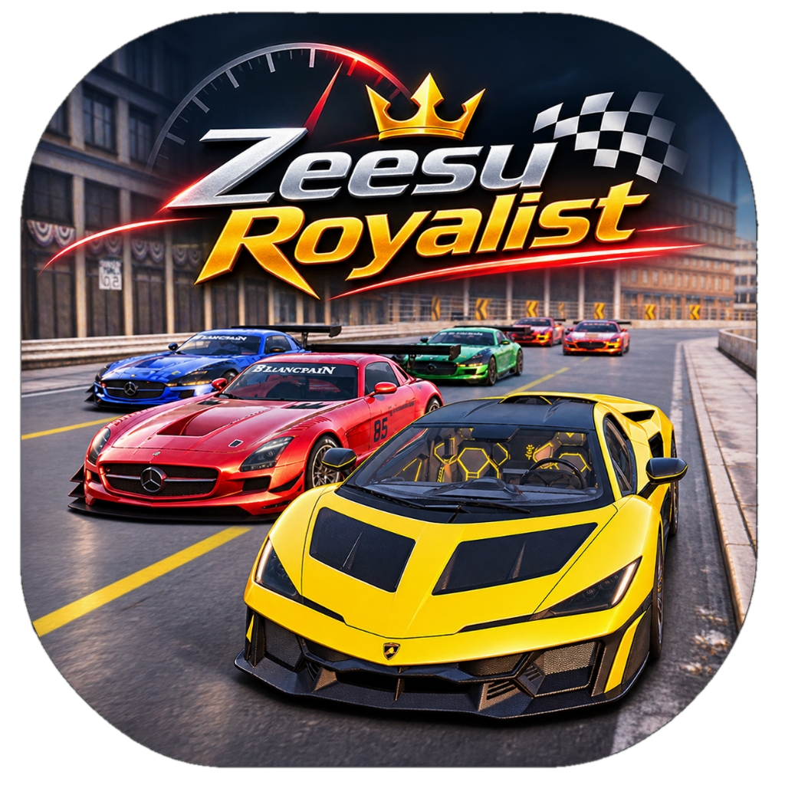

# 🏎️ Z-Race — 3D City Car Racing Simulator

<p align="center">
  
</p>

A high-performance 3D car racing game built with **React**, **Three.js**, **React Three Fiber (R3F)**, **Drei**, and **Three-Mesh-BVH** physics, powered by your custom 3D city terrain (`terrain_retextured.glb`).

---

## 🚀 Quick Start

The dev server runs with:

```bash
npm run dev
```

Open your browser at:
👉 **[http://localhost:5173/](http://localhost:5173/)**

---

## 🎮 Game Controls

| Key / Action | Function |
|---|---|
| **W** / **Up Arrow** / Gas Pedal | Accelerate (Gas) |
| **S** / **Down Arrow** / Brake Pedal | Brake & Reverse |
| **A** / **D** / Left & Right Arrows | Steer Left & Right (speed-sensitive) |
| **SPACEBAR** / Drift Button | Handbrake / Power Drift |
| **LEFT SHIFT** / Nitro Button | Nitro Boost (+65% horsepower surge & exhaust flame) |
| **R** | Instant Reset upright on the road |
| **C** | Cycle Camera Modes (Chase ➔ Action ➔ Hood/Cockpit ➔ Free Orbit) |
| **T** | Cycle Atmosphere (Day ➔ Golden Sunset ➔ Cyberpunk Night) |
| **L** | Toggle High-Beam Headlights |
| **M** | Mute / Unmute Procedural Sound Engine |

> 📱 **Touchscreen Support**: Virtual on-screen steer buttons, gas, brake, handbrake, and nitro boost buttons appear automatically on mobile, tablet, and touch screens.

---

## 🏙️ 3D City Environment Features

- **Real-Scale City**: 850m × 816m urban terrain loaded from `public/city models/terrain_retextured.glb`.
- **BVH Raycast Collision**: Uses `three-mesh-bvh` for sub-millisecond 4-wheel raycast suspension and building wall obstacle bounce.
- **Lighting & Atmosphere**:
  - Realistic Sun & Skybox with ACESFilmic tone mapping.
  - Golden Sunset with warm golden hour lighting and long shadows.
  - Cyberpunk Night with working streetlights along the boulevard and projected car headlight cones.
- **Checkered Start Gantry**: Starting grid on the main boulevard at `(10, 0.4, -9)`.
- **City Radar / Mini-Map**: Live top-down 2D radar in the top-right corner tracking car position and heading in real time.

---

## 🏁 Grand Prix Circuit Race Mode

Click **"START RACE"** in the top bar to trigger the circuit mode:
- 8 holographic glowing laser checkpoint gates placed strategically around the city streets.
- Real-time lap timer, split counter, and best lap record tracking.
- Confetti celebration upon crossing the final finish line!

---

## 🏎️ How to Add Your Custom 3D Car Model

A dedicated **GARAGE & 3D MODEL** manager is built into the game. Whenever you have your 3D car model ready:

1. Copy your `.glb` model into:
   ```
   public/cars-models/
   ```
   *(e.g., `public/cars-models/my_supercar.glb`)*

2. Open the game in your browser and click the **"GARAGE"** button (or Wrench icon) in the top header.

3. In the input box, enter your model path:
   ```
   /cars-models/my_supercar.glb
   ```
   and click **"Apply Model"**!

4. Your custom 3D car model will instantly spawn and drive in the city with full raycast physics, drift mechanics, engine audio, and camera follow!

### 💡 Tips for Exporting Your Car from Blender:
- **Format**: GLTF Binary (`.glb`).
- **Origin / Pivot**: Center of the chassis at ground level (between the 4 wheels).
- **Scale**: Real-world meters (Car length ~4.2m - 4.6m, width ~1.9m - 2.0m, height ~1.2m).
- **Material**: Name your car body material `body` or `paint` if you want the in-game color palette (Apex Red, Cyber Cyan, Midnight Black, etc.) to customize your paint finish.

---

## 👨‍💻 Creator & Developer

- **Developer**: **Zeesu Royalist**
- **Website & Portfolio**: [https://zeesu-royalist.vercel.app](https://zeesu-royalist.vercel.app)
- **Project**: Z-Race — 3D Cyber City Racing Simulator

---

## 🔊 Procedural Audio Engine

Built using the **Web Audio API** with zero external audio file dependencies:
- Dynamic RPM engine rumble and harmonics scaling seamlessly from 900 to 8000 RPM.
- Turbo blow-off valve sound when shifting gears or easing off the throttle.
- High-frequency tire squeal and smoke audio when power drifting.
- Deep bass impact thud on wall collisions.
- Futuristic checkpoint chime sounds.

